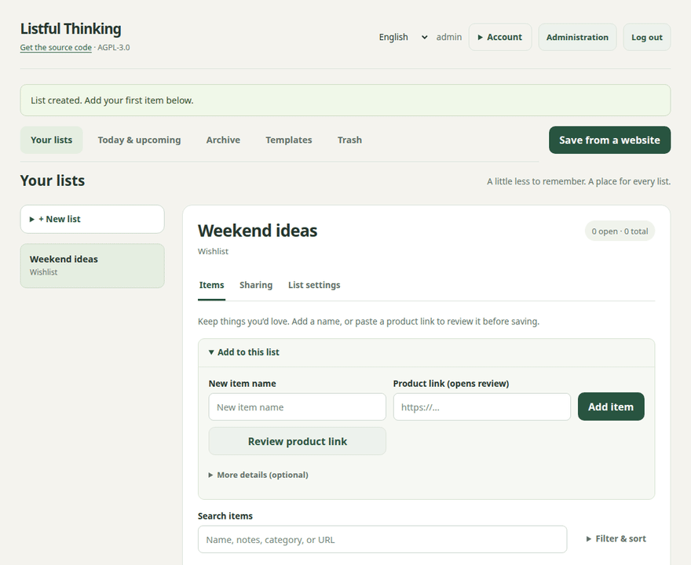
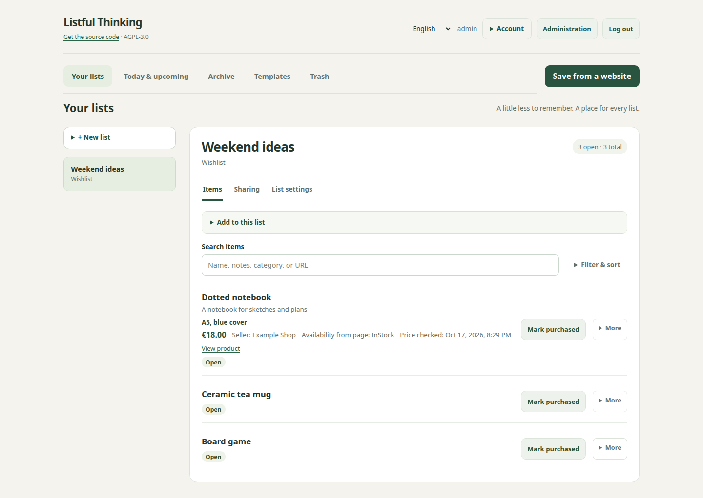
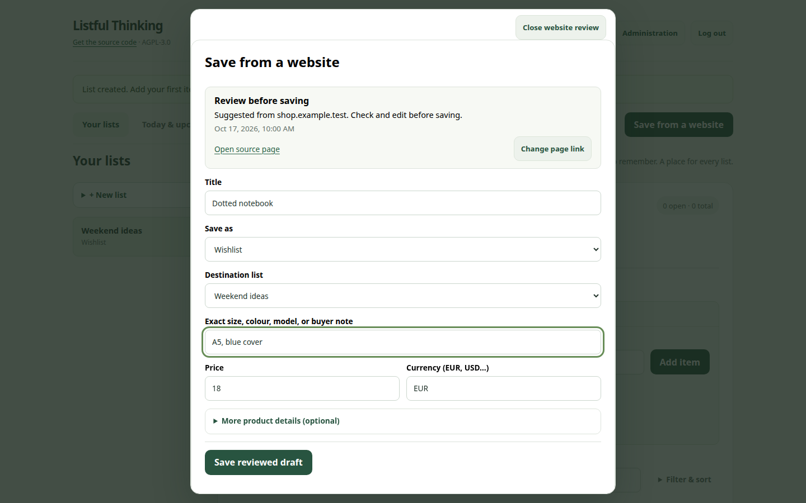
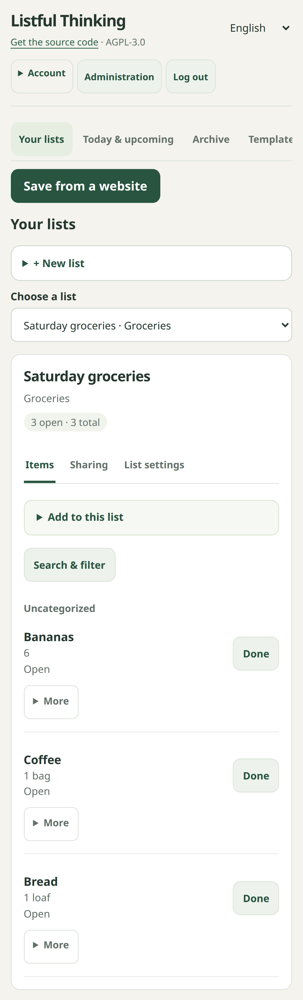

# Listful Thinking

**Turn useful web pages into private, shareable lists you host yourself.** Paste a product, recipe, event, or how-to link; review the suggested details; and save it as a wish, groceries, an event plan, or tasks. You can also create lists directly for to-dos and chores.

**Try it locally:** [run the prebuilt RC3 image](#try-the-prebuilt-image-locally) · **Host it publicly:** [Docker + Caddy HTTPS guide](docs/deployment/public-self-hosting.md) · **See the release:** [v0.2.0-rc.3](https://github.com/utrost/Listful-Thinking/releases/tag/v0.2.0-rc.3)

Listful Thinking is licensed under [GNU AGPL v3.0 only](LICENSE). The app shows a source-code link to its users, including guests. Release images point that link at the matching source tag; custom image builders can set `SOURCE_CODE_URL` to their corresponding source repository when building.

It is meant for a household, family, club, care team, or small private group that wants shared lists without adopting a full productivity suite or sending list data to a hosted service. You run the app with one SQLite database and, for public HTTPS, a Caddy container. You create local users and decide explicitly which lists stay private, which are shared with other registered users, and which get a public guest link.

The [user experience concept](docs/design/user-experience.md) describes the list workspace, navigation, user guidance, and browser validation. [Get support or report a problem](SUPPORT.md).

Want to help? Read [CONTRIBUTING.md](CONTRIBUTING.md), or follow the [independent self-hoster feedback script](docs/beta-feedback.md).

## Screenshots

These show the current app with fictional lists and website metadata. They are captured from a disposable instance by [Playwright](frontend/tests/gui/docs-screenshots.spec.ts).

**Website capture in four steps** — open the review, read a public page, correct the draft, and save it to a wishlist. The short animation uses fictional page details, captured with Playwright.



**Wishlist workspace** — collect exact wishes, prices, seller details, and source links.



**Website review** — inspect suggested details and choose a destination before saving.



**Mobile grocery list** — add and review items on a phone-sized screen.



Regenerate the static images with `cd frontend && npm run docs:screenshots`, and the animation with `scripts/build-demo-gif.sh` (also needs `ffmpeg`). Both start a disposable Playwright container and use fictional data.

## Release and branch status

The private Alice Tailnet instance runs merged commit `ea97030` at schema **V18**. It includes 14-day recoverable Trash, 56-day public links, account and ownership handoffs, reviewed website capture, richer wishlist details, and guest reservation controls. The [Alice deployment record](docs/deployment/alice-tailnet.md) documents the verified image, migration, and database backup. Rolling back to a V17 image requires its matching pre-V18 database backup. See the [current state and risk register](docs/current-state-and-risk-register.md).

The [RC3 GitHub prerelease](https://github.com/utrost/Listful-Thinking/releases/tag/v0.2.0-rc.3) is public. Its [tag workflow](https://github.com/utrost/Listful-Thinking/actions/runs/39059482487) passed all gates and published a signed amd64/arm64 image at `sha256:c16ef4edd27a6ff367e84ef8451d6d7a00ce10d644259939887b2a786ecbe743`. The [RC3 notes](docs/releases/0.2.0-rc.3.md) cover changes and limits. Features merged after this tag, including the desktop bookmarklet, are available from source until the next image release.

## What it does

- **Typed lists:** create `WISH`, `TODO`, `GROCERY`, `CHORE`, and `EVENT` lists with type-specific fields and validation.
- **Private by default:** users see their own lists unless another user shares a list with them.
- **Registered-user collaboration:** list owners can share read-only or contributor access with another local account. Contributors can add and update items; owners keep destructive/list-management control.
- **Account and ownership handoffs:** admins can issue one-time setup/recovery links, users can change passwords, owners can transfer lists to active users, and admins can transfer lists from inactive accounts without browsing private content.
- **Public guest sharing:** owners can create public links with modes for read-only viewing, wishlist claiming, or signup-style participation.
- **Website capture:** paste an HTTP(S) page, review product/recipe/event/how-to suggestions, then save wishes, grocery lines, dated event plans, or tasks. Wishlist entries keep exact variants, seller, availability, source, and price-check time. A possible duplicate is flagged before saving.
- **Shared city trips (current source):** create a City trip list, invite friends by account name with Can contribute access, and collect places from reviewed website links. Each place keeps its source link, optional image and note, and the contributor's account name. Matching links receive a duplicate warning. Trip contributions require accounts; public trip links only allow viewing.
- **Guest reservation control:** claimants can correct their name or release a reservation from the same browser; an owner can release a mistaken claim. Wishlist owners and other guests do not see the claimant's name.
- **Grocery/shop mode:** use quantity/category fields, group by category, hide completed items, and clear completed grocery items after shopping.
- **Chores and events:** use due dates, simple recurrence for chores, skip/postpone actions, target dates for events, and owner/helper labels for coordination.
- **Notifications:** due-item reminders and sharing/ownership changes appear in-app; reminders can also be sent by email when SMTP is configured.
- **Admin bootstrap:** the first account needs a server setup code and becomes admin; admins can manage registration, create users with a password or setup link, activate/deactivate users, and inspect per-user list counts.

## Architecture and deployment posture

The current implementation is an MVP/post-MVP private self-hosting foundation:

- Spring Boot backend with session auth, CSRF protection, Flyway migrations, SQLite persistence, URL scraping, reminders, admin endpoints, and security hardening.
- Vue frontend served by the backend as a single web app.
- Single-container Docker build path with persistent `/app/data` volume.
- Automated smoke, unit, and Playwright coverage for auth, admin settings/users, typed lists, account setup, password change, handoffs, sharing, capture, item workflows, guest reservations, and container runtime checks.

Deployment posture: **small independent self-hosted instances**, with a [public HTTPS Compose profile](docs/deployment/public-self-hosting.md). See the [Self-Hosting Handbook](docs/deployment/self-hosting-handbook.md) and [Current state and risk register](docs/current-state-and-risk-register.md) for operational limits.

### Save from a website

Open **Save from a website** after signing in, or paste a **Product link** while adding to a wishlist. Both routes open the same review with the current wishlist already selected when applicable. Check the suggested title, destination, variant, price, and any optional details before saving. Products can become wishlist items; recipe ingredients become editable grocery lines; how-to steps become tasks; and events become dated lists with a location and optional preparation tasks. If a public page cannot be read, the page link remains in a manual draft. Line imports keep unsaved lines available for retry if a later save fails. This captures a snapshot, with no ongoing synchronization or automatic price tracking. On the current source build, a desktop bookmarklet under **Save from a website** can open the current page in review; browser content policies may block it, so pasting the link remains the fallback. Mobile Web Share Target integration is not yet available.

For a group visit, make a **City trip** list and invite each friend by account name from **Sharing**. Can contribute is preselected for this list type. A contributor can paste a place URL in **Items**, review the suggested title, note, and image, and save it to the shared shortlist. A matching link prompts a warning before saving. The list records who suggested each place. The current flow collects places; it does not build an itinerary or map.

Live Playwright checks used real [MUJI](https://www.muji.eu/products/set-of-5-planted-tree-paper-notebooks-b5-4594), [Good Food](https://www.bbcgoodfood.com/recipes/easy-pancakes), [Berliner Philharmoniker](https://www.berliner-philharmoniker.de/en/concert/calendar/57042/), and [King Arthur Baking](https://www.kingarthurbaking.com/recipes/simply-perfect-pancakes-recipe) pages. The MUJI URL redirected to a German localized page, so its suggested title and final source URL were localized; both were visible for review. See the [dated extraction evidence](docs/domain/scraping.md).

## Requirements

For the recommended container path:

- Docker with Docker Compose v2
- `curl` and `python3` if you want to run the smoke script

For local development without Docker:

- Java 17
- Maven 3.9+
- Node.js/npm compatible with the frontend toolchain (`package-lock.json` is committed; the Docker build currently uses Node 24)

## Try the prebuilt image locally

This runs RC3 on your own computer without building Java or frontend dependencies. It binds to loopback, so it is for a local trial only; use the [HTTPS profile](docs/deployment/public-self-hosting.md) for access from the internet.

```bash
git clone https://github.com/utrost/Listful-Thinking.git
cd Listful-Thinking
scripts/create-bootstrap-secret.sh
docker compose -f compose.try.yml up -d
docker compose -f compose.try.yml ps
```

Open `http://localhost:8080`, register the first account, and enter the setup code from `secrets/bootstrap-token`. Your lists live in a separate persistent trial volume. Stop with `docker compose -f compose.try.yml down`; this keeps the volume. On later starts, keep the existing secret file and skip `scripts/create-bootstrap-secret.sh`. The default image is the public RC3 release. To pin its exact bits, set `LISTFUL_IMAGE=ghcr.io/utrost/listful-thinking@sha256:c16ef4edd27a6ff367e84ef8451d6d7a00ce10d644259939887b2a786ecbe743` in your shell before `up`.

## Build from source with Docker Compose

Use this for local development or to try changes merged after RC3:

```bash
cp .env.example .env
python3 -c 'import secrets; print(secrets.token_urlsafe(48))'
# Paste that random value into BOOTSTRAP_TOKEN in .env.
docker compose --env-file .env up --build
```

Then open:

```text
http://localhost:8080
```

On a fresh database, register the first account in the browser using the setup code from `.env`. That account becomes `ADMIN`. Later self-registration is disabled by default unless you enable it through admin settings or start with `REGISTRATION_ENABLED=true`.

Stop the app with:

```bash
docker compose down
```

Remove the app container and the development SQLite volume only when you deliberately want to delete local app data:

```bash
docker compose down -v
```

## Production self-hosting Compose profile

For a longer-lived self-hosted instance, use the production Compose profile and explicit environment file:

```bash
cp .env.example .env
# edit .env: BOOTSTRAP_TOKEN, PUBLIC_BASE_URL, LISTFUL_BIND/LISTFUL_PORT, mail if needed
mkdir -p data
sudo chown 1000:1000 data
docker compose --env-file .env -f compose.prod.yml up --build -d
curl -fsS http://localhost:8080/api/v1/health
```

The production profile differs from the quickstart in a few important ways:

- It uses a host-visible data bind mount controlled by `LISTFUL_DATA_BIND` instead of an anonymous-looking named volume.
- It sets `restart: unless-stopped` and a container healthcheck.
- It binds to `127.0.0.1:8080` by default, so a same-host reverse proxy can reach the app while the app port is not directly public.
- It keeps public-internet behavior opt-in: set `PUBLIC_BASE_URL=https://...` and `SESSION_COOKIE_SECURE=true` only when HTTPS is actually terminating in front of the app.

For the full operator guide, including private LAN/Tailnet versus public HTTPS deployment choices, see [Self-Hosting Handbook](docs/deployment/self-hosting-handbook.md).

## Public HTTPS self-hosting

Use the shipped [public Docker runbook](docs/deployment/public-self-hosting.md): set your domain and the pinned RC3 image in `.env.public`, generate the first-admin setup secret, then start `compose.public.yml`. Caddy handles HTTPS while the app has no public host port. The profile enables secure cookies, proxy-aware rate limiting, a read-only app filesystem, and resource limits. Run `scripts/backup-public.sh` on a schedule and `scripts/upgrade-public.sh` when changing image versions. RC3 passed strict dependency and container scans before publishing its signed amd64/arm64 image with SBOM and provenance. The [release page](https://github.com/utrost/Listful-Thinking/releases/tag/v0.2.0-rc.3) includes a checksummed source archive.

```bash
cp .env.public.example .env.public
# Set LISTFUL_DOMAIN, PUBLIC_BASE_URL and a published LISTFUL_IMAGE in .env.public.
scripts/create-bootstrap-secret.sh
docker compose --env-file .env.public -f compose.public.yml config --quiet
docker compose --env-file .env.public -f compose.public.yml up -d
```

The complete [public Compose example](compose.public.yml) and [Caddyfile](Caddyfile.public) are also shown with operating notes in the [handbook](docs/deployment/self-hosting-handbook.md#public-https-example-with-caddy). The app is reachable at `https://YOUR_DOMAIN` after DNS and TLS are ready. Use the secret from `secrets/bootstrap-token` to create the first admin.

## Data and backups

The container stores its database at:

```text
/app/data/listful-thinking.sqlite
```

The default Compose file mounts that path as the named volume:

```text
listful-data:/app/data
```

For consistent backups, use `python3 scripts/backup-db.py data/listful-thinking.sqlite backups/listful-thinking.sqlite` with a host bind mount. The helper uses SQLite online backup and verifies integrity; do not copy a live database with plain `cp`. For named volumes and a restore walkthrough, see the [Self-Hosting Handbook](docs/deployment/self-hosting-handbook.md). If you use a bind mount, create it so the container user can write to it:

```bash
mkdir -p data
sudo chown 1000:1000 data
```

Then change the Compose volume entry to:

```yaml
volumes:
  - ./data:/app/data
```

## Configuration

The app is designed to start with no required external services. Useful environment variables are:

```env
SYSTEM_LANG=en
REGISTRATION_ENABLED=false
BOOTSTRAP_TOKEN=
PUBLIC_HOSTING=false
PUBLIC_BASE_URL=http://localhost:8080
SESSION_COOKIE_SECURE=false
MAIL_HOST=
MAIL_PORT=25
MAIL_USER=
MAIL_PASS=
MAIL_AUTH=false
MAIL_STARTTLS=false
MAIL_FROM=
RATE_LIMIT_ENABLED=true
RATE_LIMIT_MAX_REQUESTS=60
RATE_LIMIT_WINDOW_SECONDS=60
RATE_LIMIT_MAX_BUCKETS=10000
TRUST_FORWARDED_FOR=false
MAX_REQUEST_BODY_BYTES=5100000
SCRAPER_ALLOW_PRIVATE_ADDRESSES=false
CSRF_ENABLED=true
```

Common choices:

- The default Compose file forwards all variables listed above, so `docker compose up` and `docker compose config` should show the same runtime settings you intend to run.
- Set `PUBLIC_BASE_URL` to the URL users will open, especially when public share or email links should point at a Tailnet/reverse-proxy hostname.
- Set `BOOTSTRAP_TOKEN` to a random secret of at least 32 characters before creating the first admin. Keep `REGISTRATION_ENABLED=false` after that; use the admin panel to create more users. The public profile mounts a secret file instead of putting the code in Compose environment output.
- Set `SESSION_COOKIE_SECURE=true` only when the app is served over HTTPS. For HTTPS deployments, verify a login response sets the session cookie with the `Secure` attribute before exposing the instance beyond a private network.
- Leave mail variables empty if you do not need email login/reset/reminders; in-app login and notifications still work.
- `MAX_REQUEST_BODY_BYTES` is explicitly bounded but defaults high enough for wishlist image data URLs (up to 5,000,000 characters); browser uploads are limited to 3.5 MB before encoding.

## Build and run manually for development

The Docker build performs these steps automatically. For local development, run them explicitly.

Build the frontend:

```bash
cd frontend
npm ci
npm run build
cd ..
```

Copy the built frontend into the backend static resources:

```bash
rm -rf backend/src/main/resources/static
mkdir -p backend/src/main/resources/static
cp -R frontend/dist/. backend/src/main/resources/static/
```

Run backend tests and package the application:

```bash
cd backend
mvn test
mvn package
cd ..
```

Run the packaged app with a local SQLite database path:

```bash
mkdir -p data
LISTFUL_DB_PATH="$PWD/data/listful-thinking.sqlite" \
PUBLIC_BASE_URL="http://localhost:8080" \
java -jar backend/target/listful-thinking-*.jar
```

Then open <http://localhost:8080>.

For frontend-only development, you can run Vite:

```bash
cd frontend
npm ci
npm run dev
```

The production-style path is still the integrated Spring Boot app that serves the built frontend and `/api/v1` backend from the same origin.

## Verify a build

Run the local backend and frontend checks:

```bash
(cd backend && mvn test)
(cd frontend && npm ci && npm test && npm run build)
```

Playwright starts an isolated Docker stack with disposable SQLite data. From the repository root:

Install the Chromium browser once if Playwright has not done so: `(cd frontend && npx playwright install chromium)`.

```bash
(cd frontend && npx playwright test tests/gui/capture.spec.ts tests/gui/sharing.spec.ts)
(cd frontend && LIVE_WEB_CAPTURE=1 npx playwright test tests/gui/live-capture.spec.ts --project=chromium-desktop)
```

The first command uses deterministic fixtures for capture and guest controls. The second makes real requests to public sites and is opt-in because their content and access can change. Neither command targets Alice. See [Release verification](docs/release.md) for the full gate list.

Run the full container smoke test:

```bash
scripts/smoke.sh
```

The smoke script builds a temporary Docker Compose stack on port `18080`, waits for `/api/v1/health`, verifies the non-root container user and SQLite volume, then exercises:

- first-admin bootstrap and regular user registration
- admin settings and user management
- typed list creation and validation
- internal list sharing with contributor access
- item creation/update/status workflows
- list cloning
- public share modes
- wishlist guest claiming and non-wishlist signup
- reminder-related fields and responsibility labels
- security hardening checks such as request-size and rate-limit behavior

To keep the smoke stack around for debugging after a failure:

```bash
LISTFUL_KEEP_SMOKE=true scripts/smoke.sh
```

To change the temporary smoke port:

```bash
LISTFUL_SMOKE_PORT=18081 scripts/smoke.sh
```

## Repository layout

```text
backend/     Spring Boot API, auth, persistence, Flyway migrations, tests
frontend/    Vue/Vite app, type-specific list UI, frontend tests
scripts/     Container smoke tests and script contract checks
docs/        Product, user/admin, domain, API, architecture, deployment, and planning docs
Dockerfile   Multi-stage frontend + backend + JRE image build
docker-compose.yml Local single-container runtime with a persistent SQLite volume
```

## Documentation

Start here:

- [User and admin guide](docs/user-guide.md)
- [Current state and risk register](docs/current-state-and-risk-register.md)
- [Product vision](docs/product/vision.md)
- [Personas and actors](docs/product/personas.md)
- [Terminology](docs/product/terminology.md)
- [Use cases and story backlog](docs/product/use-cases.md)
- [User stories](docs/product/user-stories.md)
- [MVP acceptance criteria](docs/product/acceptance-criteria.md)

Domain and architecture:

- [Architecture](docs/architecture.md)
- [API](docs/api.md)
- [Domain model](docs/domain/domain-model.md)
- [Item responsibility metadata](docs/domain/item-responsibility.md)
- [Permissions and sharing](docs/domain/permissions-and-sharing.md)
- [List types](docs/domain/list-types.md)
- [Website extraction and scraping](docs/domain/scraping.md)
- [Reminders and notifications](docs/domain/reminders.md)
- [Security architecture](docs/architecture/security.md)
- [Architecture decisions](docs/architecture/architecture-decision-records.md)
- [Release verification](docs/release.md)
- [Self-Hosting Handbook](docs/deployment/self-hosting-handbook.md)
- [Alice Tailnet deployment](docs/deployment/alice-tailnet.md)

Planning:

- [MVP roadmap](docs/mvp-roadmap.md)
- [MVP scope](docs/planning/mvp-scope.md)
- [Implementation slices](docs/planning/implementation-slices.md)

Privacy controls and deployment boundaries are documented in the [personal-data security review](docs/security-review-2026-09-26.md).
